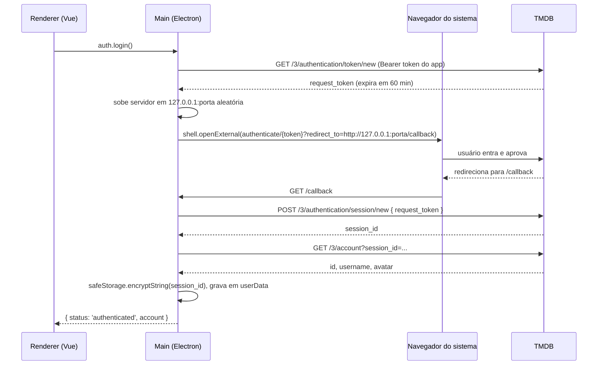
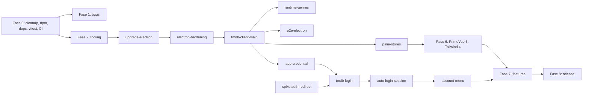

# Plano de melhoria: Media App (TMDB)

Base analisada: `master` em `26e53d5` (10/11/2026). Typecheck (`vue-tsc`) e lint passam hoje sem erros; os problemas abaixo são de comportamento, segurança, arquitetura e manutenção, não de compilação.

Observação de premissa: o app usa a API do **TMDB** (themoviedb.org), não do IMDb. O IMDb não tem API pública gratuita para esse uso; o TMDB devolve o `imdb_id` de cada título, então dá para linkar para o IMDb a partir da tela de detalhes (ver `feat/media-details`).

---

## 1. Resumo executivo

1. **Remover o token do usuário é possível e é o caminho certo.** Hoje o app mistura duas coisas diferentes: a credencial do *aplicativo* (quem está chamando a API) e a identidade do *usuário* (de quem é a watchlist). O usuário não deveria fornecer a primeira. O app passa a ter a própria credencial, a busca funciona sem login nenhum, e o login vira opcional, só para recursos de conta.
2. **"Login automático" vira dois comportamentos concretos:** (a) abrir o app e buscar sem configurar nada; (b) depois de entrar uma vez com a conta TMDB (fluxo de aprovação no navegador, sem o app ver a senha), a sessão fica guardada criptografada pelo sistema operacional e é restaurada sozinha a cada abertura.
3. **Antes do login, a segurança do Electron precisa ser ligada.** Hoje `nodeIntegration: true` e `contextIsolation: false`: qualquer XSS vira execução de código na máquina. Guardar uma sessão de usuário nesse cenário é imprudente.
4. **Há bugs visíveis agora:** paginação calculada com o campo errado, uma requisição por tecla sem debounce (respostas antigas sobrescrevem novas), e o build empacotado provavelmente quebra rotas e a imagem padrão.
5. **Stack desatualizada:** Electron 30 (atual 45), PrimeVue 3 (atual 5), ESLint 8 (atual 10), Vite 5 (atual 8). Sem testes, sem CI.

Caminho crítico até "sem token": `Fase 0` → `Fase 3` → `refactor/tmdb-client-main` → `feat/app-credential`. Há um atalho na seção 5.

### Andamento

| Fase | Situação | Onde |
|------|----------|------|
| 0. Fundação | Feita. Limpeza, npm e dependências entraram pelos PRs #44 e #45. O Vitest e o CI se perderam no squash do #46 (só os scripts do `package.json` entraram) e foram refeitos na branch da Fase 1 | `staging`, `fix/phase-1-bugs` |
| 1. Bugs atuais | Feita, aguardando PR | `fix/phase-1-bugs` |
| 2 em diante | A fazer | |

---

## 2. Diagnóstico

Severidade: **A** = alta (bug visível, risco de segurança ou bloqueia o roadmap), **M** = média, **B** = baixa.

| # | Área | Achado | Evidência | Sev. | Resolve em |
|---|------|--------|-----------|------|-----------|
| 1 | Segurança | `nodeIntegration: true` e `contextIsolation: false` na janela principal e na janela do `open-win` | `electron/main/index.ts:56-57`, `:108-109`; `vite.config.ts:89` | A | `security/electron-hardening` |
| 2 | Segurança | CSP com `'unsafe-inline' 'unsafe-eval'` | `index.html:8-9` | M | `security/electron-hardening` |
| 3 | Segurança | Handler IPC `open-win` de template, não usado, abre janela com Node ligado e hash arbitrário | `electron/main/index.ts:104` | M | `security/electron-hardening` |
| 4 | Segurança | Chave do usuário em `localStorage` (`useStorage('api_key')`) e enviada na query string (`?api_key=`), que aparece em logs | `src/components/Home/TokenInput.vue:7`; `src/util/tmdb.js:21` | M | `feat/app-credential` |
| 5 | Supply chain | `.yarnrc.yml` não versionado com `npmMinimalAgeGate: 0`, `approvedGitRepositories: "**"` e `enableScripts: true`: desliga as proteções do Yarn contra pacote recém-publicado e dependência git arbitrária | `.yarnrc.yml` | M | `chore/package-manager-npm` |
| 6 | Bug | Paginator recebe `total_pages` como `total-records` e o tamanho da página atual como `rows`; o número de páginas sai errado e o paginador não reseta numa busca nova | `src/services/searchMediaLogic.ts:30`; `src/views/Search/SearchPage.vue:24-25` | A | `fix/search-pagination` |
| 7 | Bug | Requisição a cada `keyup` (inclusive setas e Shift), sem debounce nem cancelamento; resposta antiga pode sobrescrever a mais nova; lista pisca porque `results` é zerado antes de cada chamada | `src/components/Search/SearchBar.vue:25`; `searchMediaLogic.ts:13` | A | `fix/search-debounce-race` |
| 8 | Bug (prod) | `createWebHistory()` com `loadFile` (`file://`): no app empacotado as rotas tendem a não casar. Hash mode é o indicado para Electron com `file://` | `src/router/index.ts:30` | A | `fix/packaged-build` |
| 9 | Bug (prod) | Imagem padrão aponta para a string literal `/src/assets/default_search.jpg`, que vai assim para o bundle e só existe no dev server (conferido no `dist/`). Os logos da tela Sobre funcionam: o Vite resolve o `new URL(...)` dinâmico | `searchMediaLogic.ts:42` | A | `fix/packaged-build` |
| 10 | Bug | Gêneros não mudam ao trocar idioma: `locale.value` lido uma vez, sem reatividade | `src/components/Search/SearchItemCard.vue:11` | M | `fix/search-card-details` |
| 11 | Bug | Ano vira `NaN` quando o título não tem data de lançamento | `SearchItemCard.vue:55` | B | `fix/search-card-details` |
| 12 | Bug | `fallbackLocale` igual ao locale atual (não há fallback real) | `src/plugins/i18n.ts:21` | B | `fix/search-card-details` |
| 13 | UX | Erro via `alert()` com texto quebrado (`Message: + ...`); com chave vazia, um alerta 401 por tecla | `searchMediaLogic.ts:33-35` | M | `fix/search-card-details` |
| 14 | Performance | Pôsteres carregados em tamanho `original` (vários MB por card) | `src/util/tmdb.js:54` | M | `fix/search-card-details` |
| 15 | Dados errados | Versões da tela Sobre fixas e trocadas (VueUse mostra a versão do Vue, Prettier mostra a do Vite) | `src/util/constants.ts:24-35` | B | `fix/about-versions` |
| 16 | Arquitetura | `tmdb.js` vendorizado (43 KB, XHR, sem tipos) para usar duas funções | `src/util/tmdb.js` | M | `refactor/tmdb-client-main` |
| 17 | Arquitetura | Estado global em `ref`s soltos de módulo; Pinia instalado e não usado | `src/services/searchMediaLogic.ts:5-10` | M | `refactor/pinia-stores` |
| 18 | Arquitetura | Gêneros gerados por script com chave colada à mão (`<ADD TMDB API KEY HERE>`) | `src/util/fetchGenres.js`, `generatedGenres.ts` | B | `feat/runtime-genres` |
| 19 | Manutenção | Dois lockfiles (`package-lock.json` e `yarn.lock`, este com 9 mil linhas alteradas e não commitadas), `yarn` listado como dependência, `.npmrc` com opções do pnpm que o npm 11 ignora com aviso | raiz | M | `chore/package-manager-npm` |
| 20 | Manutenção | `dependencies` contém pacotes que o Vite já empacota no bundle do renderer (`primevue`, `primeicons`, `bootstrap`, `@popperjs/core`) e até o `yarn`; o electron-builder copia todo `dependencies` para dentro do `app.asar`, inflando o instalador. Bootstrap só importa CSS, que conflita com o preflight do Tailwind | `package.json`; `src/style.css:1` | M | `chore/deps-hygiene`, `chore/upgrade-tailwind-4` |
| 21 | Manutenção | Preset `src/presets/lara/` inteiro sem uso (o app usa `wind`) | `src/main.ts` | B | `chore/repo-cleanup` |
| 22 | Manutenção | 26 branches `dependabot/*` obsoletas no remoto (referem-se a uma árvore antiga: karma, express, electron 18) e 2 branches já mergeadas | `git branch -r` | B | `chore/repo-cleanup` |
| 23 | Qualidade | Zero testes, zero CI | sem `.github/` | A | `test/vitest-setup`, `ci/github-actions` |
| 24 | Release | `appId: 'YourAppID'`, sem `productName`, Linux só `snap`; título da janela "Main window"; tema nativo forçado em `dark` mesmo com alternador de tema | `electron-builder.json5:5,26`; `electron/main/index.ts:45,76` | M | `chore/electron-builder-config`, `security/electron-hardening` |
| 25 | Stack | Electron 30.0.7 (EOL), PrimeVue 3.52, ESLint 8, Vite 5.2, vue-i18n 9, Tailwind 3 | `npm outdated` | M | Fase 2 e Fase 6 |

Versões mais recentes conferidas com `npm outdated` hoje: electron 45.3.0, electron-builder 26.18.0, vite 8.3.7, eslint 10.14.0, primevue 5.0.4, tailwindcss 4.3.5, vue 3.5.45, vue-router 5.5.0, pinia 4.1.0, vue-i18n 11.4.18, @vueuse/core 15.0.0, typescript 7.0.2, vue-tsc 3.3.14.

---

## 3. Autenticação: desenho proposto

### 3.1 Princípio

Separar **credencial do aplicativo** de **sessão do usuário**.

- A credencial do app (API Read Access Token do TMDB) identifica o Media App perante o TMDB. Toda chamada precisa dela, inclusive o início do login. Ela é responsabilidade de quem distribui o app, não de quem usa.
- A sessão do usuário (`session_id`) identifica a pessoa e dá acesso de escrita à conta dela (watchlist, favoritos, notas). Só é necessária para recursos de conta.

Consequência: a busca nunca exige login; o login é um botão "Entrar com TMDB" opcional.

### 3.2 Opções avaliadas para a credencial do app

| Opção | UX | Exposição da credencial | Infra/custo | Esforço |
|-------|----|-------------------------|-------------|---------|
| **A. Token embutido no build** (lido de variável de ambiente no build, só no processo main) | Excelente | Extraível do `.asar` por quem quiser. Não fica no repositório | Zero | Baixo |
| **B. Proxy próprio** (ex.: Cloudflare Worker guarda o token e repassa chamadas) | Excelente | Nunca sai do servidor; dá para limitar taxa por IP | Baixo (camada gratuita costuma bastar), mas é mais um serviço para manter | Médio |
| C. Usuário traz a própria chave (atual) | Ruim | Na máquina do usuário, em `localStorage` | Zero | Já feito |
| D. Login com usuário e senha dentro do app (`validate_with_login`) | Boa | O app manipula a senha do TMDB | Zero | Baixo |

Recomendação: **A agora, com B como evolução** se o app for distribuído publicamente e o token começar a ser abusado. A opção D é descartada: a própria documentação do TMDB trata a aprovação via site como o método preferido e o login com senha como substituto para quem não tem navegador. Manter C apenas como *override avançado* nas configurações ("usar minha própria chave"), útil se o token embutido for revogado.

Ponto em aberto que muda a recomendação: se o app for só para uso pessoal ou de poucas pessoas, A é suficiente para sempre. Se houver binários públicos em GitHub Releases, planeje B.

### 3.3 Fluxo de login (TMDB v3, aprovação no navegador)

Sequência documentada pelo TMDB: criar *request token* (expira em 60 minutos se não for usado), mandar o usuário para `https://www.themoviedb.org/authenticate/{REQUEST_TOKEN}` com `redirect_to` opcional, e depois trocar o token aprovado por um `session_id` em `POST /3/authentication/session/new`. O TMDB orienta tratar o `session_id` como senha.

Para um app desktop, o `redirect_to` aponta para um servidor HTTP efêmero em loopback (`127.0.0.1`, porta aleatória), padrão recomendado para apps nativos (RFC 8252). Custom protocol (`media-app://`) foi descartado: exige registro no sistema, arquivo `.desktop` no Linux e se comporta diferente em dev.



Regras do servidor de loopback:

- Escutar só em `127.0.0.1`, porta `0` (o SO escolhe), uso único; fecha no primeiro callback válido ou após 5 minutos.
- Não confiar nos parâmetros do callback: o main já guarda o `request_token` pendente e chama `session/new` com ele. Se o usuário negou, `session/new` falha e o estado vira `error: 'denied'`. Assim, outro processo local que acerte a porta não consegue nada.
- Responder uma página HTML curta no idioma do app ("Pronto, pode fechar esta aba").
- **Fallback sem redirect:** se a porta não abrir ou o navegador não voltar, a UI mostra "Já autorizei no navegador"; o botão chama `session/new` com o mesmo token. Funciona porque a troca depende só de o token estar aprovado.

### 3.4 Login automático na abertura

1. `app.whenReady()` → `sessionStore.load()` descriptografa o arquivo.
2. Sem arquivo: estado `anonymous`.
3. Com sessão: `GET /3/account?session_id=...`.
   - 200: `authenticated` com os dados da conta.
   - 401: sessão revogada pelo usuário no site; apaga o arquivo, estado `anonymous`.
   - Erro de rede: **não** desloga. Estado `authenticated` com flag `offline`, nova validação quando a rede voltar. Deslogar por falta de internet seria um bug irritante.
4. O renderer pergunta o estado via `auth.getSession()` no boot e assina `auth.onChange`.

A documentação do TMDB não informa prazo de expiração para `session_id`; o desenho acima não depende disso, porque valida a cada abertura.

### 3.5 Armazenamento seguro

- `session_id` (e a chave do override, se usada) ficam **apenas no processo main**, criptografados com `safeStorage` do Electron (Keychain no macOS, DPAPI no Windows, Secret Service/KWallet no Linux), em `app.getPath('userData')`, arquivo com permissão `0600`.
- O renderer nunca recebe o `session_id`; recebe só `{ id, username, avatarPath }`.
- Linux sem chaveiro: o Electron cai para um backend de texto simples. Verificar com `safeStorage.getSelectedStorageBackend()` (confirmar a API na versão de Electron adotada); nesse caso, avisar e perguntar se o usuário quer lembrar a sessão. Se não, a sessão vive só em memória.

```ts
// electron/main/auth/session-store.ts
import { app, safeStorage } from 'electron';
import { readFile, writeFile, rm } from 'node:fs/promises';
import { join } from 'node:path';

const sessionFile = () => join(app.getPath('userData'), 'session.bin');

export async function saveSession(sessionId: string): Promise<void> {
  if (!safeStorage.isEncryptionAvailable()) {
    throw new Error('storage-unavailable');
  }
  await writeFile(sessionFile(), safeStorage.encryptString(sessionId), { mode: 0o600 });
}

export async function loadSession(): Promise<string | null> {
  try {
    return safeStorage.decryptString(await readFile(sessionFile()));
  } catch {
    return null;
  }
}

export const clearSession = () => rm(sessionFile(), { force: true });
```

### 3.6 Logout

`DELETE /3/authentication/session` com `{ session_id }`, depois `clearSession()`. Se a chamada remota falhar (offline), apaga localmente mesmo assim.

### 3.7 Contrato IPC (preload com `contextBridge`)

```ts
// shared/ipc.ts (tipos compartilhados entre main e renderer)
export type MediaType = 'movie' | 'tv';

export type SessionState =
  | { status: 'anonymous' }
  | { status: 'pending'; expiresAt: number }
  | { status: 'authenticated'; offline: boolean; account: { id: number; username: string; avatarPath?: string } }
  | { status: 'error'; reason: 'denied' | 'timeout' | 'network' | 'storage-unavailable' };

export interface MediaApi {
  tmdb: {
    search(p: { type: MediaType | 'multi'; query: string; page: number; language: string }): Promise<Paged<MediaSummary>>;
    details(p: { type: MediaType; id: number; language: string }): Promise<MediaDetails>;
    genres(language: string): Promise<Genre[]>;
    trending(p: { type: MediaType | 'all'; window: 'day' | 'week'; language: string }): Promise<Paged<MediaSummary>>;
  };
  auth: {
    getSession(): Promise<SessionState>;
    login(): Promise<SessionState>;
    confirmManual(): Promise<SessionState>;
    cancelLogin(): Promise<void>;
    logout(): Promise<void>;
    onChange(cb: (s: SessionState) => void): () => void;
  };
  account: {
    setWatchlist(p: { type: MediaType; id: number; value: boolean }): Promise<void>;
    setFavorite(p: { type: MediaType; id: number; value: boolean }): Promise<void>;
    rate(p: { type: MediaType; id: number; value: number | null }): Promise<void>;
    list(p: { kind: 'watchlist' | 'favorite' | 'rated'; type: MediaType; page: number }): Promise<Paged<MediaSummary>>;
  };
}
```

O preload expõe `window.api` com `contextBridge.exposeInMainWorld('api', ...)`; cada método vira um `ipcRenderer.invoke` com canal fixo. O main valida os argumentos (tipo, faixa de página, tamanho da query) antes de chamar o TMDB.

### 3.8 Injeção do token no build

```ts
// vite.config.ts (trecho)
import { defineConfig, loadEnv } from 'vite';

export default defineConfig(({ mode }) => {
  // prefixo '' carrega TMDB_READ_TOKEN de .env.local sem expor ao renderer
  const env = loadEnv(mode, process.cwd(), '');
  return {
    plugins: [
      electron([
        {
          entry: 'electron/main/index.ts',
          vite: {
            define: { __TMDB_READ_TOKEN__: JSON.stringify(env.TMDB_READ_TOKEN ?? '') },
            // build: { ... }
          },
        },
      ]),
    ],
  };
});
```

- Sem prefixo `VITE_`, o Vite não injeta a variável no bundle do renderer.
- `.env.local` já é ignorado pelo `.gitignore` (`*.local`). Commitar um `.env.example` com `TMDB_READ_TOKEN=`.
- No CI, o token vem de um *secret* do repositório; o workflow de release falha se ele estiver vazio.
- Usar o header `Authorization: Bearer` em vez de `?api_key=`: o TMDB documenta os dois com o mesmo nível de acesso, e o header não vaza em logs de URL.

### 3.9 Spike antes de implementar (máximo 2 horas)

Branch descartável `spike/tmdb-auth-redirect`, sem merge. Confirmar na prática:

1. O TMDB aceita `redirect_to=http://127.0.0.1:<porta>/callback` (a documentação não restringe nem confirma).
2. Quais parâmetros chegam no callback (espera-se algo como `request_token` e `approved`, mas o desenho não depende disso).
3. `GET /3/account` com `session_id` responde 401 depois de revogar a sessão no site.

Se o item 1 falhar, o fallback "Já autorizei" vira o fluxo principal; nada mais muda.

---

## 4. Fluxo Git

- **Integração em `staging`:** todo PR entra em `staging` por *squash merge*. `master` recebe `staging` nos marcos, junto com a tag.
- **Uma branch, um PR, só os próprios commits.** Criar cada branch a partir do `origin/staging` atualizado. Nunca empilhar uma branch em cima de outra ainda não mergeada: depois do squash da primeira, a segunda repete os commits dela no PR.
- **Trabalho que depende de outro ainda não mergeado** vai na mesma branch (um PR só) ou espera o merge.
- **Correções que mexem nos mesmos arquivos** vão numa branch só, com um commit por correção, em vez de várias branches que conflitam entre si.
- **Conferir depois de cada merge** que o squash trouxe os arquivos esperados: `git show --stat origin/staging`.
- **Nome de branch:** `<tipo>/<escopo-curto-em-kebab-case>`. Tipos: `feat`, `fix`, `refactor`, `chore`, `ci`, `test`, `docs`, `security`, `spike` (este nunca é mergeado).
- **Commits:** Conventional Commits em inglês, com autor único (sem `Co-Authored-By` nem outras linhas de atribuição).
- **Título do PR** = mensagem do commit de squash. Corpo: o quê, por quê, como testar, screenshots se houver UI.
- **Tags por marco:** `v0.2.0` (Fases 0 e 1), `v0.3.0` (Fases 2 e 3), `v0.4.0` (Fases 4 e 5, sem token e com login), `v0.5.0` (Fase 6), `v1.0.0` (Fases 7 e 8).
- **Node:** 26 no CI; `engines` aceita a partir do 22.12.

```bash
git fetch origin
git switch -c fix/search-pagination origin/staging
```

---

## 5. Roadmap por fase

Tamanho: **P** até 1 dia, **M** 2 a 3 dias, **G** 1 semana ou mais (estimativa grosseira para uma pessoa).

**Atalho, se o token precisa sumir já:** fazer `feat/app-credential` logo após a Fase 1, injetando o token no bundle do renderer via `define`. Em termos de exposição é quase equivalente (o token é extraível do `.asar` de qualquer jeito); o custo é retrabalho quando `refactor/tmdb-client-main` mover o token para o main. O login (Fase 5) **não** deve pular a Fase 3.

### Fase 0: Fundação

**0.1 `chore/repo-cleanup`** (P)
- [ ] Apagar branches remotas mergeadas: `feature/api-token-input`, `refactoring`.
- [ ] Fechar PRs e apagar as 26 branches `dependabot/*` obsoletas.
- [ ] Remover `src/presets/lara/` e `src/presets/lara.d.ts`.
- [ ] Remover assets não referenciados (conferir com `grep` antes).
- [ ] Atualizar a árvore do README (cita `stores/` e `styles/`, que não existem).
- Aceite: `git branch -r` lista só `master`; build e lint continuam passando.
- Commits: `chore: remove unused lara preset`, `docs: fix project structure in README`.

```bash
git push origin --delete feature/api-token-input refactoring
git branch -r | grep 'origin/dependabot/' | sed 's#origin/##' | xargs -n1 git push origin --delete
```

**0.2 `chore/package-manager-npm`** (P)
- [ ] Padronizar em npm (já há `package-lock.json`, o README usa npm, e o npm 11 vem com o Node 24 instalado aqui).
- [ ] Descartar a alteração local do `yarn.lock`, apagar `yarn.lock`, `.yarn/` e `.yarnrc.yml` (confirme antes que não há nada seu ali).
- [ ] Limpar `.npmrc` (as opções `shamefully-hoist` e `strict-peer-dependencies` são do pnpm).
- [ ] Adicionar `"engines": { "node": ">=22" }` e `"packageManager"` no `package.json`.
- [ ] Atualizar README.
- Aceite: `rm -rf node_modules && npm ci && npm run dev` funciona; sem avisos de config desconhecida.
- Commit: `chore: standardize on npm and drop yarn artifacts`.

**0.3 `chore/deps-hygiene`** (P)
- [ ] Regra para Electron com Vite: `dependencies` só recebe o que o processo main carrega em runtime sem passar pelo bundle (ex.: `electron-store`, `electron-updater` no futuro). Tudo que o Vite empacota no renderer fica em `devDependencies`, porque o electron-builder copia `dependencies` inteiro para o `app.asar`.
- [ ] Mover `primevue`, `primeicons` e `bootstrap` para `devDependencies`; remover `yarn` e `@popperjs/core`.
- [ ] Medir o `app.asar` antes e depois com `electron-builder --dir`.
- Aceite: build empacotado abre igual e o `app.asar` não contém mais `node_modules` do renderer.
- Commit: `chore(deps): keep bundled packages out of production dependencies`.

**0.4 `test/vitest-setup`** (P)
- [ ] Vitest + `@vue/test-utils` + `happy-dom`; script `test` e `test:watch`.
- [ ] Primeiros testes: `getGenreNames` e `getMediaAttributesByType`.
- Aceite: `npm test` verde localmente.
- Commit: `test: set up vitest with first unit tests`.

**0.5 `ci/github-actions`** (P)
- [ ] `.github/workflows/ci.yml`: em PR e push no `master`, `npm ci`, `lint` (sem `--fix`; criar script `lint:check`), `vue-tsc --noEmit`, `test`, `vite build`.
- [ ] `.github/dependabot.yml`: semanal, agrupando minor/patch de devDependencies num PR só.
- [ ] `.github/pull_request_template.md` com o checklist da seção 8.
- [ ] Ativar proteção de `staging` e `master` exigindo o check do CI.
- Aceite: PR de teste mostra o check verde.
- Commit: `ci: add lint, typecheck, test and build workflow`.

### Fase 1: Bugs atuais (cada um com teste de regressão)

Entregue numa branch só, `fix/phase-1-bugs`, com um commit por correção: os cinco itens mexem nos mesmos arquivos e a branch também repõe o Vitest e o CI perdidos no #46. Diferenças em relação ao que estava planejado abaixo:

- Erros de busca aparecem numa mensagem na própria página, não em Toast: o estado fica visível enquanto durar e não empilha avisos a cada tentativa.
- Entraram quatro correções que não estavam na lista: a busca cortava o texto no `&` ("tom & jerry"), o ano saía um a menos para lançamentos de 1º de janeiro em fusos atrás do UTC, os cards mostravam "undefined (NaN)" ao trocar entre filme e série, e a chave salva só era carregada ao abrir a Home.
- A atribuição do TMDB (texto e logo oficiais) saiu do item 1.5 e foi para o 8.1, porque depende de baixar o logo e conferir o texto nos termos.

**1.1 `fix/search-pagination`** (P)
- [ ] Guardar `total_results` (não `total_pages`) e usar `rows` fixo em 20.
- [ ] Ligar `:first="(page - 1) * 20"` para o paginador refletir e resetar a página.
- [ ] Limitar a 500 páginas (limite da API do TMDB; confirmar na documentação de busca).
- Aceite: busca com mais de 20 resultados mostra o número certo de páginas; nova busca volta para a página 1.
- Commit: `fix(search): use total_results for paginator and reset page on new query`.

```vue
<Paginator
  :first="(page - 1) * 20"
  :rows="20"
  :total-records="Math.min(totalResults, 500 * 20)"
  @page="search($event.page + 1)"
/>
```

**1.2 `fix/search-debounce-race`** (P)
- [ ] Trocar `@keyup` por `watchDebounced` (VueUse) de 350 ms sobre `query` e `mediaType`.
- [ ] Mínimo de 2 caracteres; query vazia limpa os resultados sem chamar a API.
- [ ] Descartar resposta obsoleta com contador de sequência (e `AbortController` quando a chamada for via `fetch`).
- [ ] Estado `loading` com skeleton; não zerar `results` antes da resposta chegar.
- Aceite: digitar "matrix" rápido gera 1 requisição; a mensagem "nenhum resultado" não aparece durante o carregamento.
- Commit: `fix(search): debounce input and ignore stale responses`.

```ts
let seq = 0;
async function search(page = 1) {
  const id = ++seq;
  loading.value = true;
  try {
    const res = await api.search({ type: mediaType.value, query: query.value, page, language: locale.value });
    if (id !== seq) return; // resposta antiga, descarta
    results.value = res.results;
    totalResults.value = res.total_results;
    currentPage.value = res.page;
  } finally {
    if (id === seq) loading.value = false;
  }
}
watchDebounced([query, mediaType], () => search(1), { debounce: 350 });
```

**1.3 `fix/packaged-build`** (P)
- [ ] `createWebHashHistory()` no router.
- [ ] Imagem padrão via `import defaultPoster from '@/assets/default_search.jpg'`.
- [ ] Conferir com `electron-builder --dir` e abrir o binário gerado: navegar por todas as rotas e buscar algo sem pôster.
- Aceite: app empacotado abre na Home, navega e mostra a imagem padrão.
- Commit: `fix(router): use hash history for file:// in packaged app`.

**1.4 `fix/search-card-details`** (P)
- [ ] Gêneros reativos ao idioma (`computed` sobre `locale`).
- [ ] Ano só quando houver data válida.
- [ ] `fallbackLocale: 'en'`.
- [ ] Pôster em `w342` com `srcset` para `w500`; `loading="lazy"` nas imagens.
- [ ] Trocar `alert()` por Toast do PrimeVue com mensagem traduzida; corrigir o texto do erro.
- [ ] Chaves novas de i18n nos três idiomas.
- Commits: `fix(search): make genre names reactive to locale`, `fix(i18n): set english as fallback locale`, `perf(search): load sized posters lazily`, `fix(search): show errors in toast instead of alert`.

**1.5 `fix/about-versions`** (P)
- [ ] Gerar as versões a partir do `package.json` no build (`define` com as versões resolvidas) em vez de constantes.
- Commit: `fix(about): read dependency versions from package.json`.

### Fase 2: Ferramentas e ecossistema

**2.1 `chore/upgrade-minors`** (P)
- [ ] `npm update` dentro dos majors atuais (vue 3.5, vite 5.4, typescript 5.9, vue-tsc 2.2, etc.).
- Commit: `chore(deps): update packages within current majors`.

**2.2 `chore/eslint-flat-config`** (M)
- [ ] ESLint 10 com `eslint.config.js` (flat config), `typescript-eslint` 8, `eslint-plugin-vue` 10, `@vue/eslint-config-typescript` 14, `eslint-config-prettier` 10.
- [ ] Remover `eslint-plugin-prettier` e rodar Prettier separado (`format:check` no CI): mais rápido e sem conflito de regras.
- [ ] Portar as regras atuais; apagar `.eslintrc.js` e `.eslintignore`.
- Aceite: `npm run lint:check` passa sem mudar arquivos.
- Commit: `chore(lint): migrate to eslint flat config`.

**2.3 `chore/upgrade-vite`** (M)
- [ ] Vite 8, `@vitejs/plugin-vue` 6, `vite-plugin-electron` 1.x, `unplugin-auto-import` 21, `vue-tsc` 3.
- [ ] Remover `vue/macros` da lista do AutoImport (Reactivity Transform saiu do core do Vue).
- [ ] Avaliar `electron-vite` como substituto de `vite-plugin-electron`; decidir no PR.
- Aceite: dev com HMR, build e app empacotado funcionando.
- Commit: `chore(build): upgrade to vite 8`.

**2.4 `chore/upgrade-vue-ecosystem`** (M)
- [ ] vue-router 5, pinia 4, vue-i18n 11, @vueuse/core 15. Ler o guia de migração de cada um.
- Commit: um por pacote, por exemplo `chore(deps): upgrade vue-i18n to v11`.

TypeScript 7 fica para depois: esperar o `vue-tsc` suportar oficialmente.

### Fase 3: Segurança do Electron (pré-requisito do login)

**3.1 `chore/upgrade-electron`** (M)
- [ ] Electron 30 → 45 e electron-builder 24 → 26. Ler os *breaking changes* de cada major no caminho; o app usa pouca API do Electron, então o risco é baixo.
- Aceite: dev e build nos três sistemas (pelo menos Linux local; Windows e macOS no CI da Fase 8).
- Commit: `chore(electron): upgrade to electron 45`.

**3.2 `security/electron-hardening`** (M)
- [ ] `contextIsolation: true`, `nodeIntegration: false`, `sandbox: true`.
- [ ] Remover `nodeIntegration` do `vite-plugin-electron-renderer` (ou o plugin inteiro, se nada mais precisar dele).
- [ ] Remover o handler `open-win`.
- [ ] Preload com `contextBridge` expondo só a API tipada da seção 3.7.
- [ ] CSP de produção sem `unsafe-eval`: `default-src 'self'; img-src 'self' https://image.tmdb.org data:; style-src 'self' 'unsafe-inline'; connect-src 'self'`. Testar se o PrimeVue precisa de `style-src 'unsafe-inline'`.
- [ ] Bloquear navegação: `will-navigate` só para a própria origem; `setWindowOpenHandler` só abre `https://` de uma lista (`themoviedb.org`, `imdb.com`, `youtube.com`).
- [ ] `session.setPermissionRequestHandler` negando tudo.
- [ ] Título da janela com o nome do app; `nativeTheme.themeSource` acompanhando o alternador de tema.
- [ ] Trocar o `v-html` do `LogoItem.vue` por renderização normal (`v-for` em `<span>`).
- [ ] Expor `process.versions` (Electron, Node, Chrome) pelo preload: a tela Sobre lê hoje do `process` do renderer, que deixa de existir com o isolamento, e cairia para a versão do Node de quem fez o build.
- Aceite: no DevTools, `typeof require === 'undefined'` e `typeof process === 'undefined'`; checklist de segurança do Electron sem alertas.
- Commit: `fix(electron): enable context isolation and sandbox`.

### Fase 4: Camada de dados

**4.1 `refactor/tmdb-client-main`** (G)
- [ ] Cliente novo em `electron/main/tmdb/` com `fetch`, header `Bearer`, timeout (`AbortSignal.timeout`), retry em 429 respeitando `Retry-After`, erro tipado.
- [ ] URL base configurável por `TMDB_BASE_URL` (necessário para os testes E2E).
- [ ] Tipos em `shared/` (`MediaSummary`, `MediaDetails`, `Paged<T>`, `Genre`).
- [ ] Handlers IPC em `electron/main/ipc/`, com validação dos argumentos.
- [ ] Renderer passa a usar `window.api`; apagar `src/util/tmdb.js`.
- Aceite: busca e paginação idênticas ao comportamento corrigido da Fase 1; testes unitários do cliente com `fetch` simulado.
- Commits: `refactor(api): add typed tmdb client in main process`, `refactor(api): expose tmdb client to renderer through ipc`, `refactor: remove vendored tmdb.js`.

```ts
// electron/main/tmdb/client.ts
const BASE = process.env.TMDB_BASE_URL ?? 'https://api.themoviedb.org/3';

export async function tmdb<T>(path: string, params: Record<string, string | number | undefined> = {}, init: RequestInit = {}): Promise<T> {
  const url = new URL(BASE + path);
  for (const [k, v] of Object.entries(params)) if (v !== undefined) url.searchParams.set(k, String(v));

  for (let attempt = 0; ; attempt++) {
    const res = await fetch(url, {
      ...init,
      headers: { Authorization: `Bearer ${getAppToken()}`, 'Content-Type': 'application/json', ...init.headers },
      signal: AbortSignal.timeout(8000),
    });
    if (res.status === 429 && attempt < 2) {
      await new Promise((r) => setTimeout(r, Number(res.headers.get('Retry-After') ?? 1) * 1000));
      continue;
    }
    if (!res.ok) throw new TmdbError(res.status, await res.json().catch(() => null));
    return (await res.json()) as T;
  }
}
```

**4.2 `refactor/pinia-stores`** (M)
- [ ] `useSearchStore` (query, tipo, página, resultados, loading, erro), `useSessionStore` (espelho de `SessionState`), `useSettingsStore` (idioma, tema, região).
- [ ] Apagar `src/services/searchMediaLogic.ts`.
- [ ] Testes dos stores com a API simulada.
- Commit: `refactor(state): move search state to pinia store`.

**4.3 `feat/runtime-genres`** (P)
- [ ] Buscar gêneros de filme e série por idioma na API, com cache em disco no main (validade de 7 dias).
- [ ] Apagar `generatedGenres.ts`, `fetchGenres.js`, `languages.js` e a dependência `axios`.
- Commit: `feat(genres): fetch genres at runtime with disk cache`.

**4.4 `test/e2e-electron`** (M)
- [ ] Playwright com `_electron.launch`, servidor TMDB falso local apontado por `TMDB_BASE_URL`.
- [ ] Cenários: abrir app, buscar, paginar, trocar idioma, trocar filme/série.
- [ ] Job no CI (Linux com `xvfb-run`).
- Commit: `test(e2e): add electron smoke tests with mocked tmdb`.

### Fase 5: Sem token e com login

**5.1 `feat/app-credential`** (P/M)
- [ ] Token do app injetado no build (seção 3.8); `.env.example`; secret `TMDB_READ_TOKEN` no GitHub.
- [ ] Remover `TokenInput.vue`, os passos de chave da Home e as chaves de i18n `homePage.step*`.
- [ ] Migração: na primeira abertura, apagar `localStorage.api_key` antigo.
- [ ] Override opcional em Configurações ("usar minha própria chave"), guardado com `safeStorage`.
- [ ] Mensagem clara se o token do app for recusado (401): sugerir atualizar o app ou usar a própria chave.
- Aceite: instalação limpa busca sem nenhuma configuração; nenhum token aparece em `git grep` nem no bundle do renderer.
- Commits: `feat(auth): ship app credential at build time`, `feat(home): remove api key setup`.

**5.2 `spike/tmdb-auth-redirect`** (P, sem merge). Ver seção 3.9.

**5.3 `feat/tmdb-login`** (G)
- [ ] `electron/main/auth/loopback.ts`, `auth/service.ts` com a máquina de estados de `SessionState`.
- [ ] Botão "Entrar com TMDB" na NavBar; tela de espera com "Cancelar" e "Já autorizei no navegador".
- [ ] Timeout de 5 minutos; tratamento de negado, rede e expiração do request token.
- [ ] Testes do serviço com TMDB simulado (aprovado, negado, timeout, porta ocupada).
- Aceite: login completo em Linux, Windows e macOS; cancelar não deixa servidor aberto (`ss -ltnp` limpo).
- Commits: `feat(auth): add tmdb login via browser approval`, `feat(auth): add manual confirmation fallback`.

**5.4 `feat/auto-login-session`** (M)
- [ ] `session-store.ts` (seção 3.5) e validação no boot (seção 3.4).
- [ ] Linux sem chaveiro: pergunta se deve lembrar a sessão.
- [ ] Logout (seção 3.6).
- Aceite: fechar e abrir o app mantém logado; revogar no site do TMDB e reabrir desloga; abrir sem internet não desloga.
- Commit: `feat(auth): persist encrypted session and restore on startup`.

**5.5 `feat/account-menu`** (P)
- [ ] Avatar e nome na NavBar, menu com "Minha lista", "Favoritos", "Sair".
- [ ] Guarda de rota para páginas de conta (redireciona para login).
- Commit: `feat(nav): add account menu with logout`.

### Fase 6: Migração de UI

Feita antes das features novas para não construir telas duas vezes.

**6.1 `chore/upgrade-primevue`** (G)
- [ ] PrimeVue 3 → 5 seguindo os guias de migração (v4 trocou o sistema de temas; o preset `wind` copiado do repositório `primevue-tailwind` é da v3 e deve ser substituído pelo tema/plugin oficial).
- [ ] Apagar `src/presets/wind/`.
- [ ] Checklist visual de cada tela em claro e escuro.
- Commit: `chore(ui): upgrade primevue to v5`.

**6.2 `chore/upgrade-tailwind-4`** (M)
- [ ] Tailwind 4 com `@tailwindcss/vite`, configuração no CSS (`@theme`), `@custom-variant dark (&:where(.dark, .dark *));` para manter o modo escuro por classe do `useDark`.
- [ ] Remover Bootstrap (`src/style.css:1` e dependência) e ajustar o que mudar de aparência.
- [ ] Apagar `tailwind.config.js` e `postcss.config.js` se não forem mais usados.
- Commit: `chore(ui): upgrade tailwind to v4 and drop bootstrap`.

### Fase 7: Funcionalidades

**7.1 `feat/media-details`** (M): rotas `/movie/:id` e `/tv/:id` com `append_to_response=credits,videos,watch/providers,external_ids`; elenco, trailer (abre no navegador), onde assistir na região do usuário, link para o IMDb pelo `imdb_id`.

**7.2 `feat/home-trending`** (P): Home com "Em alta" e "Populares", agora que a Home não tem mais os passos da chave.

**7.3 `feat/multi-search`** (P): opção "Tudo" usando `/search/multi` (filmes, séries e pessoas).

**7.4 `feat/watchlist-favorites`** (M, requer 5.x): botões no card e no detalhe, com atualização otimista; páginas "Minha lista" e "Favoritos".

**7.5 `feat/ratings`** (P, requer 5.x): nota de 0,5 a 10 no detalhe; página "Avaliados".

**7.6 `feat/watched-tracking`** (G): a API do TMDB não tem status de "assistido" nem progresso por episódio. Proposta: registro local no main (arquivo JSON via `electron-store` no MVP; SQLite se crescer), com marcação por episódio para séries e "assistido em" para filmes. Opcionalmente, marcar como assistido ao avaliar. Decidir o armazenamento num spike curto.

**7.7 `feat/settings-page`** (P): idioma, tema, região para "onde assistir", chave própria (override), limpar cache.

### Fase 8: Distribuição

**8.1 `chore/electron-builder-config`** (P): `appId` real (ex.: `io.github.alebl.mediaapp`), `productName`, Linux com AppImage e deb além do snap, ícones em todos os tamanhos. Antes de publicar binários, adicionar na tela Sobre a atribuição exigida pelos termos do TMDB (logo oficial e o aviso "This product uses the TMDB API but is not endorsed or certified by TMDB"; confirmar o texto atual nos termos de uso da API).

**8.2 `ci/release-workflow`** (M): workflow disparado por tag `v*`, matriz Linux/Windows/macOS, `TMDB_READ_TOKEN` do secret, publica no GitHub Releases.

**8.3 `feat/auto-update`** (M): `electron-updater` com GitHub Releases. Sem assinatura de código, o Windows mostra aviso do SmartScreen e o macOS não aplica atualização automática; decidir se vale pagar certificados.

**Opcional `feat/tmdb-proxy`** (M, repositório separado): Worker que guarda o token, aceita só caminhos da lista usada pelo app, cacheia respostas públicas e limita taxa por IP. O cliente da 4.1 passa a apontar `TMDB_BASE_URL` para o proxy. Fazer se houver distribuição pública e sinais de abuso do token.

---

## 6. Dependências entre branches



Paralelizável: Fase 1 em paralelo com a Fase 2; o spike de auth pode rodar a qualquer momento.

---

## 7. Riscos

| Risco | Impacto | Mitigação |
|-------|---------|-----------|
| Token embutido extraído e abusado; TMDB revoga | Todas as instalações param de buscar | Override com chave própria (5.1); proxy (opcional); monitorar erros 401 |
| TMDB não honra `redirect_to` em loopback | Login sem retorno automático | Fallback "Já autorizei" (3.3), já previsto |
| Linux sem chaveiro | Sessão não pode ser guardada com segurança | Perguntar ao usuário; sessão só em memória (3.5) |
| Migração do PrimeVue maior que o esperado | Fase 6 atrasa | Branch isolada, checklist visual, features só depois |
| Saltos de major do Electron | Quebra em API do main | App usa pouca API; ler breaking changes; E2E da 4.4 antes |
| Termos do TMDB (atribuição, uso comercial) | Bloqueio da chave | Atribuição na tela Sobre (1.5); reler termos antes de publicar binários |

---

## 8. Definição de pronto (todo PR)

- [ ] `npm run lint:check`, `npx vue-tsc --noEmit`, `npm test` e `npm run build` verdes no CI.
- [ ] Teste novo cobrindo o comportamento alterado (bug: teste que falhava antes).
- [ ] Textos novos nos três idiomas (`en`, `es`, `pt-BR`).
- [ ] UI: screenshot claro e escuro no PR.
- [ ] Nenhum token, chave ou `session_id` no diff ou em logs.
- [ ] README atualizado se mudou setup, script ou variável de ambiente.

---

## 9. Decisões em aberto

1. **Distribuição:** uso pessoal ou binários públicos? Define se o proxy entra no roadmap.
2. **"Assistido":** registro local (proposto) ou só listas do TMDB (watchlist e avaliados)?
3. **Assinatura de código:** pagar certificados para Windows e macOS ou aceitar os avisos?
